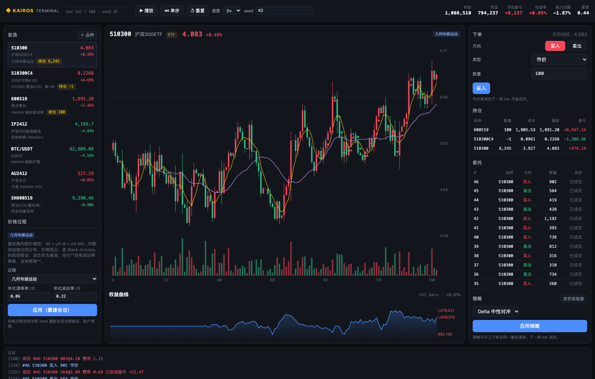
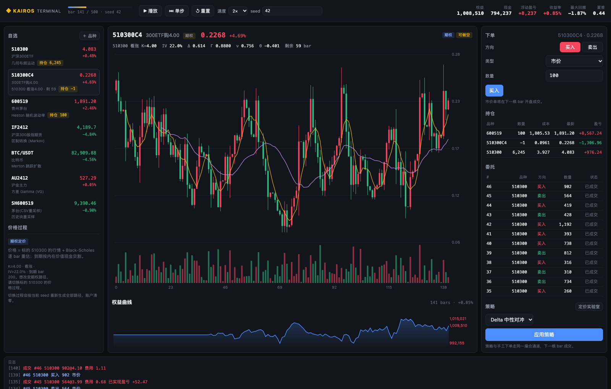

# Kairos Terminal · 随机过程交易终端

[](https://github.com/Bruce848647703/kairos-terminal/actions/workflows/ci.yml)

> **一个 QMT 式的交易终端，但「价格从哪来」由你决定。**
>
> 每个品种挂一条可插拔的随机过程：GBM、Heston、SABR、粗糙 Bergomi、GARCH、跳跃扩散、
> 区制转换、方差 Gamma、历史重采样，或者你自己写的路径生成器。终端负责 K 线、下单、
> 持仓、盈亏与**期权 Delta 对冲**；定价实验室负责用同一套过程做 Black-Scholes /
> 二叉树 / 蒙特卡洛定价与模型错配实验。

**零第三方依赖**（只用 `numpy` + 标准库），离线可跑、固定种子可复现、128 个测试 + CI。

---

## 1. 为什么需要「价格可配置」的终端

券商终端（QMT / 同花顺 / 文华）给你的是一条**已经发生**的价格序列。你能研究策略，
但没法研究「如果世界是另一个随机过程会怎样」：

- 高波动 + 跳跃的市场里，趋势策略是真的有效，还是幸存者偏差？
- 用 Black-Scholes 给一个 Heston 世界定价，Delta 对冲一年会亏多少？尾部有多厚？
- 同一张期权，在 SABR 与粗糙波动率下，短端微笑差多少？

Kairos Terminal 把「市场生成器」和「交易终端」拆开再拼起来：

```
                ┌──────────────────────┐
   你选的         │  PriceProcess        │   GBM / Heston / SABR / Rough Bergomi
   价格过程  ───► │  （可插拔的随机过程）  │   GARCH / Merton / Bates / Regime / VG …
                └──────────┬───────────┘
                           │ 路径 (n_paths × n_steps)
                  ┌────────▼────────┐        ┌────────────────────┐
                  │  MarketEngine   │  ────► │  Web 终端           │
                  │  撮合 · 保证金    │        │  K线 / 下单 / 期权   │
                  │  账户 · 盯市     │        └────────────────────┘
                  └────────┬────────┘  ────► ┌────────────────────┐
                           │                 │  定价实验室          │
                           └────────────────►│  BS / 树 / MC / 对冲 │
                                             └────────────────────┘
```

## 2. 快速开始

```bash
git clone https://github.com/Bruce848647703/kairos-terminal && cd kairos-terminal
python -m pip install -e ".[dev]"

python -m kairos_terminal                 # 打开 Web 终端（默认 http://127.0.0.1:8848）
python -m kairos_terminal demo            # 命令行跑 250 根 bar 并打印绩效
python -m kairos_terminal processes       # 列出全部价格过程与参数
python -m kairos_terminal data            # 列出可用的本地行情 CSV
python -m kairos_terminal price --process heston --vol 0.2
python -m kairos_terminal simulate --process vg --steps 252 --paths 3 --out paths.csv
python -m kairos_terminal simulate --data ashare/sh600519 --steps 252   # 真实数据重采样
```

命令行也支持 `make test` / `make serve` / `make demo`。

## 3. 终端界面



（截图为真实运行画面：左栏自选与价格过程，中间 K 线与权益曲线，右栏下单/持仓/委托，
底部成交日志。数据由 `seed=42` 的随机过程生成，非真实行情。）

要点：

- **播放 / 单步 / 倍速**：逐 bar 推进，可以停在任何一根 K 线上研究；
- **切换过程**：左侧选品种 → 换过程 → 改参数 → 应用（按当前 seed 重建全部路径）；
- **新增品种**：参数化过程 / 本地 CSV 重采样 / 期权合约，都在同一个弹窗里配置；
- **键盘**：空格播放/暂停，`→` 单步；支持 `?symbol=510300C4` 深链。

## 4. 内置价格过程

| key | 名称 | 刻画的特征 | 典型用途 |
|---|---|---|---|
| `gbm` | 几何布朗运动 | 对数正态、无记忆 | BS 基准、对照组 |
| `trend` | 确定性趋势 | 零波动 | 剥离随机性看成本 |
| `heston` | Heston 随机波动率 | 波动率聚集、杠杆效应 | 期权微笑、随机波动定价 |
| `sabr` | SABR 随机波动率 | 弹性 β、vol-of-vol、偏斜 | 微笑形状、β 直觉 |
| `rough_bergomi` | 粗糙 Bergomi | H<0.5 的分数布朗 | 粗糙波动率、短端微笑 |
| `garch` | GARCH(1,1) | 离散波动率聚集、长记忆 | 风险模型基线 |
| `two_factor` | 双因子随机波动率 | 快/慢两个方差因子 | 期限结构、长期期权 |
| `merton` | Merton 跳跃扩散 | 跳空、肥尾 | 黑天鹅、事件冲击 |
| `bates` | Bates（SV + 跳跃） | 两者叠加 | 最接近真实期权市场 |
| `ou` | 对数均值回复 | 向长期均衡回归 | 价差、商品、利率 |
| `cir` | CIR 方根过程 | 波动随水平放大、非负 | 短期利率、方差过程 |
| `regime` | 区制转换 (Markov) | 结构性突变、非平稳 | 策略/风控压力测试 |
| `vg` | 方差 Gamma | 尖峰肥尾、Lévy 跳跃 | 轻量肥尾建模 |
| `bootstrap` | 历史块重采样 | 保留真实自相关/波动聚集 | 接真实 CSV |
| `custom` | 自定义过程 | 任意 | 传一个回调即可 |

新增一个过程**只需要写一个类**：声明 `key / name / params / simulate()`，
注册表、Web 参数表单、CLI 帮助、参数校验会自动生效（见
[docs/adding-a-process.md](docs/adding-a-process.md)）。

## 5. 期权与 Delta 对冲



终端里的期权不是独立标的，而是由「标的行情 + 合约条款」推导出的可交易合约：

- 每根 bar 用 Black-Scholes 重估（做市商口径的隐含波动率 `iv`），到期按内在价值**现金交割**；
- 图表头显示实时的 Δ / Γ / ν / Θ 与剩余期限；
- 支持买入/卖出开仓（默认允许卖出开仓），持仓市值、盈亏、保证金与现货统一记账；
- 内置 **Delta 中性对冲**策略：自动卖空 1 份期权，并用标的动态对冲，按带宽再平衡。

这样「用 BS 定价与对冲一个非 BS 世界」不再是一段脚本，而是终端里一条可观察的权益曲线。

**可选微笑**：`OptionSpec(..., smile=True)` 会按行权价从 SSVI 曲面取 IV（负偏斜，
低行权价更贵），而不是全曲面共用一个常数。SSVI 来自 `kairos-vol`：

```bash
pip install -e ".[surface]"      # 可选；不装则自动退化为常数 IV
```

**真实世界**：`kairos-terminal world --data sh600519.csv` 用真实日线校准 σ/漂移/ADV，
直接生成「这只票的仿真终端」；也可以用 `--world-file` 读取 `kairos-lab` 看板产出的
`world.json`（多标的）。终端不联网、不依赖兄弟包。

**一键期权链**：界面点「＋期权链」，或调 `POST /api/chain`
（`Session.add_option_chain`）——按当前标的价生成「平值 ±1 档 × 2 个到期 × 看涨/看跌」
共 12 张合约，只重建一次会话，全部共用同一个 SSVI 微笑。

## 6. 真实数据

`kairos-data` 里已提交的 112 个后复权 CSV 可以直接变成可交易品种：

```bash
python -m kairos_terminal data                       # 浏览数据集与统计
python -m kairos_terminal simulate --data ashare/sh600519 --steps 252
python -m kairos_terminal serve                      # 终端「＋品种 → 数据来源：本地 CSV」
```

数据目录按优先级扫描：`$KAIROS_TERMINAL_DATA` → `./data` → `../kairos-data/data` →
`~/Documents/Github/kairos-data/data`。底层是**循环块重采样**（`BootstrapProcess`），
保留真实收益率的肥尾、波动率聚集与短期自相关，但不假设任何参数模型。

## 7. 定价实验室

同一份期权，四种问法：

```python
from kairos_terminal.processes import create
from kairos_terminal.pricing import (
    black_scholes, binomial_crr, monte_carlo,
    implied_vol, delta_hedge_experiment, compare_models,
)

black_scholes(100, 100, 1.0, 0.02, 0.2)          # 闭式解 + 5 个希腊字母
binomial_crr(100, 100, 1.0, 0.02, 0.2, steps=500, american=True)
monte_carlo(create("heston"), 100, 100, 1.0, 0.02,   # 用同一个过程做 MC
            n_paths=50_000, n_steps=252, seed=1)
implied_vol(8.9, 100, 100, 1.0, 0.02)            # 反解隐含波动率
delta_hedge_experiment(create("merton", lam=1.0), 100, 100, 1.0, 0.02,
                       hedge_vol=0.2)            # 模型错配下的对冲 PnL
compare_models(create("heston"), 100, 100, 1.0, 0.02, 0.2)   # 三法对照
```

`examples/02_price_under_misspecification.py` 的实测输出（卖 1 份期权，
用 σ=20% 的 BS Delta 对冲一年，4000 条路径）：

| 真实过程 | 均值 PnL | 标准差 | 5% 分位 | 亏损概率 |
|---|---:|---:|---:|---:|
| GBM σ=20%（模型正确） | -0.01 | 0.96 | -1.62 | 51.7% |
| Heston 随机波动 | **-1.31** | 2.97 | -6.92 | 62.2% |
| Merton 跳跃 | **-1.38** | 3.81 | -9.44 | 51.3% |
| VG 肥尾 | -0.02 | 4.15 | -7.53 | 40.9% |

模型正确时均值≈0，只剩离散对冲噪声；一旦真实世界有随机波动或跳跃，
BS 会系统性少收权利金 —— 这就是「模型风险」的价格。

## 8. Python API

```python
import kairos_terminal as kt
from kairos_terminal.instruments import OptionSpec

session = kt.Session(seed=42, n_steps=500)
session.step(60)                                   # 推进 60 根 bar
session.submit("510300", "buy", 1000)              # 下一根 bar 开盘成交
session.submit("IF2412", "sell", 1, order_type="limit", limit_price=4200)
session.step(1)

snap = session.snapshot()
print(snap["account"]["equity"], snap["account"]["positions"])

# 换掉某个品种的价格过程（会重建会话）
session.set_process("510300", "heston", {"v0": 0.09, "theta": 0.09, "rho": -0.8})

# 用真实 CSV 建品种 / 建一张期权
session.add_instrument("SH600519", "茅台", data_path="ashare/sh600519", block=20)
session.add_instrument("510300P4", "300ETF沽4.00", asset_class="option",
                       option={"underlying": "510300", "strike": 4.0, "kind": "put",
                               "expiry_index": 180, "iv": 0.24, "multiplier": 10000})

# 挂策略（含 Delta 中性对冲）
session.set_strategy("delta_hedge", {"option": "510300C4", "open_short": True, "band": 0.05})
```

自定义过程：

```python
import numpy as np
from kairos_terminal import Instrument, Session
from kairos_terminal.processes import CustomProcess

def my_paths(*, n_steps, dt, s0, seed, n_paths):
    rng = np.random.default_rng(seed)
    shocks = rng.standard_t(df=4, size=(n_paths, n_steps)) * 0.01
    return s0 * np.exp(np.cumsum(shocks, axis=1))

session = Session([
    Instrument(symbol="TST", name="自定义t分布", process=CustomProcess(my_paths), s0=100),
])
```

## 9. 设计原则

**无未来函数**
: 委托在「第 k 根 bar 收盘后」提交，只会在第 k 根 bar 的 OHLC 里撮合；市价单成交于
下一根开盘，限价/止损按穿越判定。引擎内部一次生成整条路径，但 Terminal 只下发
`index` 之前的数据。

**两种撮合模式**
: `matching="bar"`（默认）按 bar 开盘价 + 固定滑点成交；`matching="book"` 则用当根
bar 构造一个合成订单簿（档位深度随成交量、档间距随振幅缩放），市价单**逐档吃单**，
冲击随下单量单调上升。`kairos-terminal serve --matching book` 即可切换。

**记账恒等式**
: 对股票、期货、期权统一：`权益 = 现金 + Σ持仓保证金 + Σ浮动盈亏`。保证金率=1 时等价于
「现金换资产」；<1 时只冻结保证金，杠杆由浮动盈亏体现。买卖、做空、反手、平仓、
期权到期交割全部自动闭合，测试逐条校验。

**可复现**
: 所有随机性来自 `numpy.random.default_rng(seed)`，同 seed 同结果；价格过程、
K 线影线/成交量、撮合滑点都是确定性的。

**零依赖**
: 核心只用 `numpy` + 标准库。正态分布用 `math.erf`，Web 服务用 `http.server`，
K 线用原生 `<canvas>` 手绘，没有 npm / CDN / 前端框架。

## 10. HTTP API

| 方法 | 路径 | 说明 |
|---|---|---|
| GET | `/api/meta` | 过程/策略/品种元数据（含参数 schema） |
| GET | `/api/state?symbol=&bars=` | 终端快照：行情、账户、持仓、委托、日志 |
| GET | `/api/bars?symbol=&start=` | 增量 K 线 |
| GET | `/api/datasets?q=` | 本地行情 CSV 列表（含区间/波动/收益） |
| POST | `/api/step` | `{n}` 推进 n 根 bar |
| POST | `/api/reset` | `{seed, n_steps}` 重建会话 |
| POST | `/api/order` | `{symbol, side, qty, type, limit_price?, stop_price?}` |
| POST | `/api/cancel` | `{id}` 撤单 |
| POST | `/api/process` | `{symbol, process, params, s0?}` 切换价格过程 |
| POST | `/api/instrument` | `{action: add/remove, ...}` 增删品种（支持 `data_path` / `option`） |
| POST | `/api/strategy` | `{key, params}` 挂载/卸载策略 |
| POST | `/api/price` | `{method: bs/binomial/mc/implied_vol/hedge/compare, ...}` |

服务只监听 `127.0.0.1`，不做鉴权 —— 它是本机研究工具，不要暴露到公网。

## 11. 项目结构

```
kairos_terminal/
├── processes/          15 个价格过程（base/registry + 5 个模型文件）
├── datasets.py         本地 CSV 扫描与历史块重采样
├── instruments.py      品种定义（普通资产 / 期权合约）
├── market.py           路径 → K 线 → 逐 bar 撮合 → 期权到期结算
├── broker.py           委托/成交/持仓/保证金/盈亏
├── pricing.py          BS / 二叉树 / MC / 隐含波动率 / Delta 对冲
├── strategy.py         策略基类 + 双均线/网格/动量/Delta 中性对冲
├── analytics.py        收益/回撤/夏普/索提诺
├── session.py          会话编排（终端与 CLI 的唯一入口）
├── cli.py              命令行
└── web/                stdlib HTTP 服务 + 单页前端（canvas 手绘图）
tests/                  128 个测试
examples/               4 个可运行示例
```

## 12. 测试

```bash
python -m pytest          # 128 passed
```

覆盖：15 个过程的统计性质与确定性、参数校验、K 线不变量、无未来函数撮合、
各类委托成交价、账户记账恒等式、拒单回滚、期权定价/交割/Greeks/Delta 对冲、
本地数据解析、BS 与二叉树/MC 的收敛、隐含波动率往返、HTTP 接口全链路。

## 13. 边界与免责

- 这是**研究与教学工具**：不接任何真实券商/交易所通道，不下真单，不构成投资建议。
- 过程参数是「世界设定」，不是对真实市场的校准结果；用来做**条件分析**而非预测。
- 期权按固定隐含波动率的 BS 报价，没有校准 smile；它服务的是「模型错配」实验，
  而不是给真实期权报价。
- 回测/模拟结果依赖模型假设，模型错了结果就会错 —— 这正是本项目想让你看见的东西。

## 许可

MIT © 2026 Bruce848647703.

---

> **Kairos 系列**：[总索引](https://github.com/Bruce848647703/kairos) ·
> [kairos-data](https://github.com/Bruce848647703/kairos-data) ·
> [kairos-backtest](https://github.com/Bruce848647703/kairos-backtest) ·
> [kairos-factor](https://github.com/Bruce848647703/kairos-factor) ·
> [kairos-portfolio](https://github.com/Bruce848647703/kairos-portfolio) ·
> [kairos-risk](https://github.com/Bruce848647703/kairos-risk) ·
> [kairos-ml](https://github.com/Bruce848647703/kairos-ml) ·
> [kairos-strategies](https://github.com/Bruce848647703/kairos-strategies) ·
> [kairos-execution](https://github.com/Bruce848647703/kairos-execution) ·
> [kairos-crypto](https://github.com/Bruce848647703/kairos-crypto) ·
> [kairos-lab](https://github.com/Bruce848647703/kairos-lab) ·
> [kairos-research](https://github.com/Bruce848647703/kairos-research) ·
> **[kairos-terminal](https://github.com/Bruce848647703/kairos-terminal)**